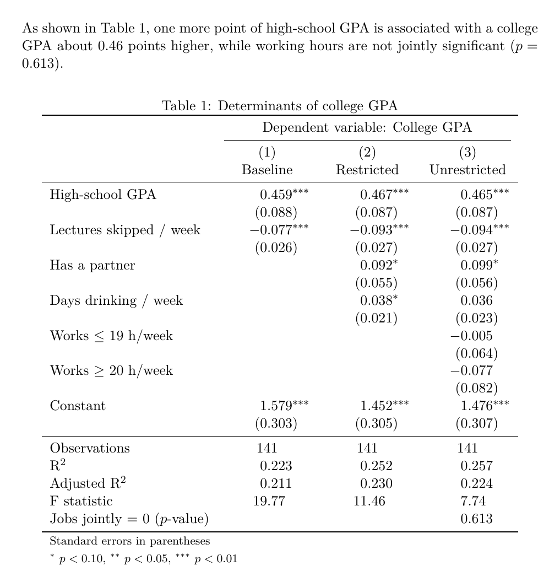
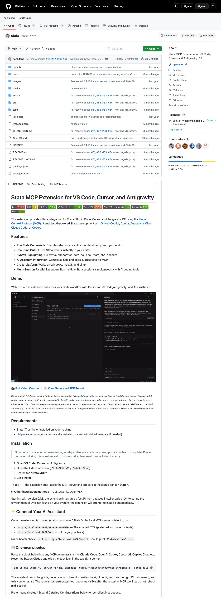
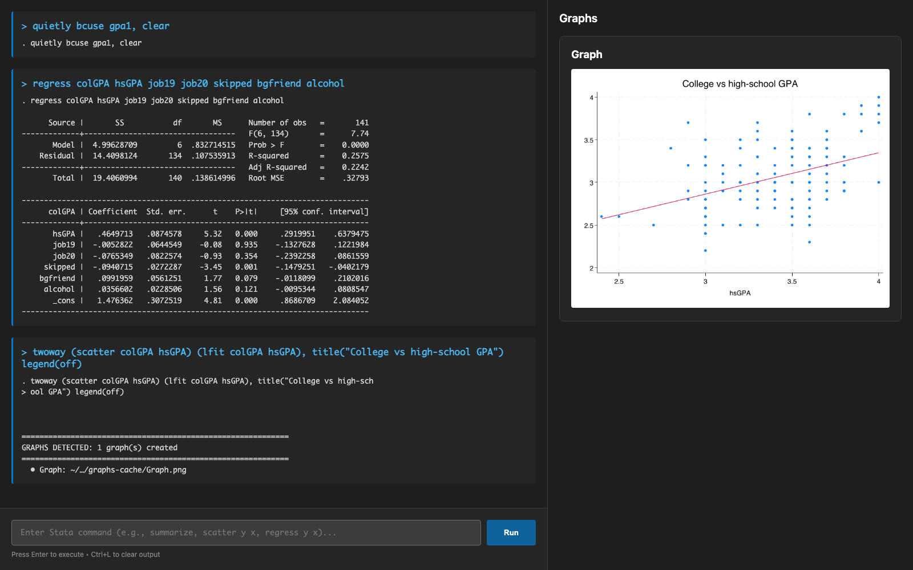
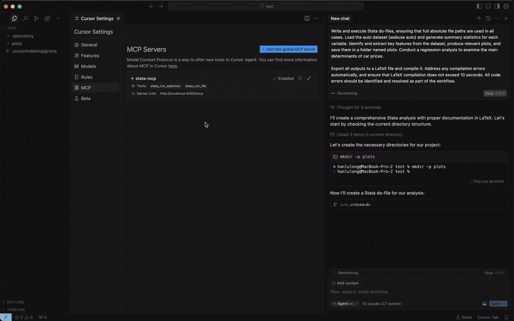
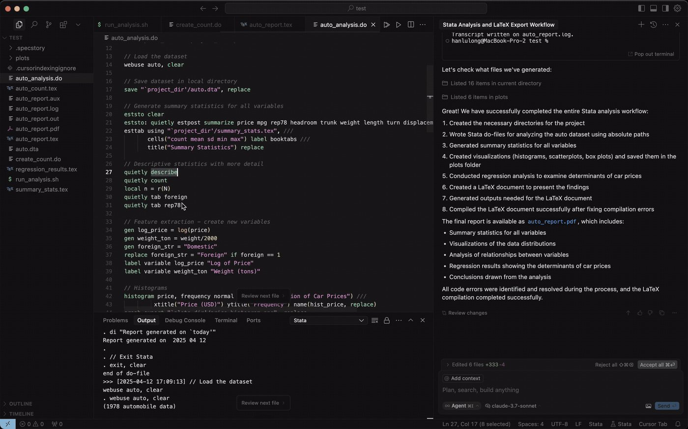
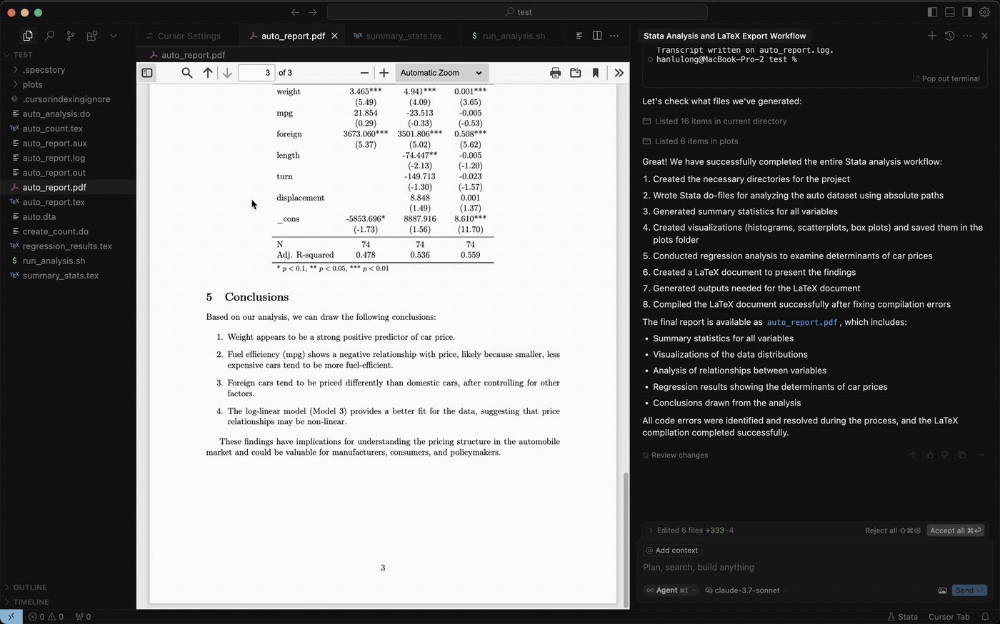

```{python}
#| echo: false
#| output: false
import sys
sys.path.insert(0, "../theme")
import bse_style
_ = bse_style.apply()

import numpy as np
import matplotlib.pyplot as plt
from scipy import stats


# Layout of the A3 answer key, colours of the slide theme (theme/bse_style.py):
# acceptance = teal, rejection = orange, p-value = purple
REJ_COLOR, REJ_FILL = bse_style.ORANGE, "#FAD5B4"         # orange, orange at 35% on white
ACC_COLOR = bse_style.TEAL
PVAL_COLOR, PVAL_FILL = bse_style.PURPLE, "#C5BDCD"   # purple, purple at 30% on white
A3_STYLE = {"font.family": "serif", "font.serif": ["cmr10"], "mathtext.fontset": "cm",
            "axes.formatter.use_mathtext": True, "axes.unicode_minus": False,
            "axes.grid": False, "font.size": 13}


def draw_brace(ax, x0, x1, y, depth, color):
    """Curly brace below the axis, opening upwards (like TikZ's mirrored brace)."""
    x = np.linspace(x0, x1, 401)
    beta = 250 / (ax.get_xlim()[1] - ax.get_xlim()[0])
    half = x[:201]
    yh = 1 / (1 + np.exp(-beta * (half - half[0]))) + 1 / (1 + np.exp(-beta * (half - half[-1])))
    yb = np.concatenate((yh, yh[-2::-1]))
    ax.plot(x, y - depth * (yb - yb.min()) / (yb.max() - yb.min()), color=color, lw=1.4,
            clip_on=False)


def f_axes(ax, x, y, xmax, xlabel):
    """Shared axes: density in black, arrowed left/bottom axes, no y ticks."""
    ax.plot(x, y, color=bse_style.BLACK, lw=1.8, zorder=3)
    top = y.max()
    ax.set_xlim(0, xmax)
    ax.set_ylim(0, top * 1.15)
    for side in ("top", "right"):
        ax.spines[side].set_visible(False)
    ax.spines["left"].set_color("black")
    ax.spines["bottom"].set_color("black")
    ax.plot(0, 1, "^k", ms=5, transform=ax.transAxes, clip_on=False)
    ax.plot(1, 0, ">k", ms=5, transform=ax.transAxes, clip_on=False)
    ax.set_yticks([])
    ax.set_ylabel("Density")
    ax.text(1, -0.36, xlabel, transform=ax.transAxes, ha="right", va="top")
    return top


def plot_f_test(q, df2, F_obs, alpha=0.05, xmax=None):
    """Two panels in the style of the A3 answer key:
    left, the decision rule (regions are values of F, drawn on the axis);
    right, the p-value (area under the density to the right of the F-value)."""
    F_crit = stats.f.ppf(1 - alpha, q, df2)
    p_value = stats.f.sf(F_obs, q, df2)
    xmax = xmax or max(F_obs, F_crit) * 1.3
    x = np.linspace(0.001, xmax, 600)
    y = stats.f.pdf(x, q, df2)
    xlabel = f"$F$ under $H_0$:  $F({q},\\,{df2})$"
    if p_value >= 0.001:
        p_txt = f"{p_value:.3f}"
    else:
        mant, expo = f"{p_value:.1e}".split("e")
        p_txt = f"{mant} \\times 10^{{{int(expo)}}}"

    with plt.rc_context(A3_STYLE):
        fig, (ax1, ax2) = plt.subplots(1, 2, figsize=(12.5, 4.1))

        # ---- decision rule ----
        top = f_axes(ax1, x, y, xmax, xlabel)
        tail = x >= F_crit
        ax1.fill_between(x[tail], y[tail], color=REJ_FILL, lw=0, zorder=2)
        ax1.plot([F_crit, F_crit], [0, stats.f.pdf(F_crit, q, df2)], "k--", lw=1.1)
        ax1.plot([0, F_crit], [0, 0], color=ACC_COLOR, lw=4.5, solid_capstyle="butt",
                 clip_on=False, zorder=4)
        ax1.plot([F_crit, xmax], [0, 0], color=REJ_COLOR, lw=4.5, solid_capstyle="butt",
                 clip_on=False, zorder=4)
        ax1.set_xticks([F_crit], [f"{F_crit:.2f}"])
        ax1.tick_params(axis="x", length=0, pad=6)
        d = 0.06 * top
        draw_brace(ax1, 0, F_crit, -0.17 * top, d, ACC_COLOR)
        draw_brace(ax1, F_crit, xmax, -0.17 * top, d, REJ_COLOR)
        ax1.text(F_crit / 2, -0.26 * top, "Acceptance region", color=ACC_COLOR, ha="center", va="top")
        ax1.text((F_crit + xmax) / 2, -0.26 * top, "Rejection region", color=REJ_COLOR,
                 ha="center", va="top")
        xa = F_crit + 0.12 * (xmax - F_crit)
        ax1.annotate(f"$\\alpha = {alpha:.0%}$".replace("%", "\\%"),
                     xy=(xa, 0.4 * stats.f.pdf(xa, q, df2)), xytext=(xa + 0.08 * xmax, 0.35 * top),
                     color=REJ_COLOR, fontsize=11, ha="left",
                     arrowprops=dict(arrowstyle="->", color=REJ_COLOR, lw=1))
        ax1.plot(F_obs, 0, "o", color="black", ms=7, clip_on=False, zorder=5)
        ax1.plot([F_obs, F_obs], [0, 0.9 * top], color="black", lw=1, zorder=5)
        ax1.text(F_obs + (-0.01 if F_obs > xmax / 2 else 0.01) * xmax, 0.92 * top, f"$F$-value $= {F_obs:.2f}$", ha="right" if F_obs > xmax / 2 else "left",
                 va="bottom", fontsize=12)

        # ---- p-value ----
        f_axes(ax2, x, y, xmax, xlabel)
        right = x >= F_obs
        ax2.fill_between(x[right], y[right], color=PVAL_FILL, lw=0, zorder=2)
        ax2.plot([F_obs, F_obs], [0, max(stats.f.pdf(F_obs, q, df2), 0.03 * top)], "k--", lw=1.1)
        ax2.set_xticks([F_obs], [f"{F_obs:.2f}"])
        ax2.tick_params(axis="x", length=0, pad=6)
        xp = F_obs + 0.15 * (xmax - F_obs)
        ax2.annotate(f"$p = {p_txt}$", xy=(xp, 0.3 * stats.f.pdf(xp, q, df2)),
                     xytext=(F_obs - 0.05 * xmax if F_obs > xmax / 2 else xp + 0.08 * xmax, 0.4 * top),
                     color=PVAL_COLOR, fontsize=12, ha="right" if F_obs > xmax / 2 else "left",
                     arrowprops=dict(arrowstyle="->", color=PVAL_COLOR, lw=1))

        fig.subplots_adjust(left=0.04, right=0.99, top=0.97, bottom=0.30, wspace=0.12)
        plt.show()
```

## Overview {background-color="#0396A6"}

- Introduction to Stata: the window, the toolbar, do-files
- The anatomy of a Stata command and its stored results
- Global hypothesis testing: is the model useful at all?
- Multiple hypothesis testing: are `job19` and `job20` jointly significant?

---

## Why These Topics?

::: {.callout-tip icon=false}
#### <svg width="16" height="16" viewBox="0 0 24 24" fill="none" stroke="currentColor" stroke-width="2"><rect x="2" y="4" width="20" height="16" rx="2"/><path d="M6 9l3 3-3 3"/><line x1="11" y1="15" x2="16" y2="15"/></svg> Stata
- The standard software in applied economics: most replication packages you will read are **do-files**
:::

::: {.callout-tip icon=false}
#### <svg width="16" height="16" viewBox="0 0 24 24" fill="none" stroke="currentColor" stroke-width="2"><path d="M3 20h18"/><path d="M5 20V10"/><path d="M10 20V5"/><path d="M15 20v-8"/><path d="M20 20v-4"/></svg> Global Hypothesis Testing
- The $F$ value at the top of every regression output: what is it testing?
:::

::: {.callout-tip icon=false}
#### <svg width="16" height="16" viewBox="0 0 24 24" fill="none" stroke="currentColor" stroke-width="2"><circle cx="9" cy="12" r="6"/><circle cx="15" cy="12" r="6"/></svg> Multiple Hypothesis Testing
- Testing **several restrictions at once**: restricted vs unrestricted model
:::

---

## Introduction to Stata {.section-divider-centered background-color="#0396A6"}

---

## What is Stata?

A **statistical software package** for data analysis, created in 1985 and still widely used in economics, political science and public health.

```{=html}
<div class="goal-cards">
  <div class="goal-card">
    <div class="goal-num">1</div>
    <div class="goal-title">Paid software</div>
    <p>Stata needs a <b>licence</b> (BE, SE or MP editions). Python and R are <b>free and open source</b>: anyone can install them, read their code and extend them.</p>
  </div>
  <div class="goal-card">
    <div class="goal-num">2</div>
    <div class="goal-title">The old standard</div>
    <p>For years it was <i>the</i> tool in statistics and econometrics: new methods from papers were released as a <b>Stata package</b> first, and often Python or R did not support them at all.</p>
  </div>
  <div class="goal-card">
    <div class="goal-num">3</div>
    <div class="goal-title">Today</div>
    <p>Most of those methods now exist in Python, and AI tools make porting a new one easy. Python adds <b>speed</b>, better <b>data manipulation</b>, and it is <b>open source</b>.</p>
  </div>
</div>
```

::: {.callout-note title="So why learn it?" icon=false}
A large share of published **replication packages** are do-files, and many research institutes, central banks and public agencies still work in Stata. You need to be able to **read and run** it.
:::

---

## The Stata window

```{=html}
<div class="app-window" style="margin-top:4px;">
  <div class="app-titlebar">
    <span class="dot dot-red"></span><span class="dot dot-yellow"></span><span class="dot dot-green"></span>
    <span class="app-title">Stata/SE 18.5 — gpa1.dta</span>
  </div>
  <div class="stata-toolbar" style="position:relative;">
    <span class="inline-marker fragment" data-fragment-index="6"><span class="ui-num purple">6</span></span>
    <span class="tb-btn" title="Open"><svg viewBox="0 0 24 24" fill="none" stroke="currentColor" stroke-width="1.8" stroke-linecap="round" stroke-linejoin="round"><path d="M3 7a2 2 0 0 1 2-2h4l2 2h8a2 2 0 0 1 2 2v1H3z"/><path d="M3 10h18l-2 9H5z"/></svg></span>
    <span class="tb-btn" title="Save"><svg viewBox="0 0 24 24" fill="none" stroke="currentColor" stroke-width="1.8" stroke-linecap="round" stroke-linejoin="round"><path d="M5 3h11l3 3v15H5z"/><path d="M8 3v5h8V3"/><rect x="8" y="13" width="8" height="6"/></svg></span>
    <span class="tb-btn" title="Print"><svg viewBox="0 0 24 24" fill="none" stroke="currentColor" stroke-width="1.8" stroke-linecap="round" stroke-linejoin="round"><path d="M6 9V3h12v6"/><rect x="3" y="9" width="18" height="8" rx="2"/><rect x="7" y="14" width="10" height="7"/></svg></span>
    <span class="tb-sep"></span>
    <span class="tb-btn" title="Log"><svg viewBox="0 0 24 24" fill="none" stroke="currentColor" stroke-width="1.8" stroke-linecap="round" stroke-linejoin="round"><rect x="5" y="3" width="14" height="18" rx="2"/><line x1="9" y1="8" x2="15" y2="8"/><line x1="9" y1="12" x2="15" y2="12"/><line x1="9" y1="16" x2="13" y2="16"/></svg></span>
    <span class="tb-btn" title="Viewer"><svg viewBox="0 0 24 24" fill="none" stroke="currentColor" stroke-width="1.8" stroke-linecap="round" stroke-linejoin="round"><path d="M2 5h7a3 3 0 0 1 3 3v12a2 2 0 0 0-2-2H2z"/><path d="M22 5h-7a3 3 0 0 0-3 3v12a2 2 0 0 1 2-2h8z"/></svg></span>
    <span class="tb-btn" title="Graph"><svg viewBox="0 0 24 24" fill="none" stroke="currentColor" stroke-width="1.8" stroke-linecap="round" stroke-linejoin="round"><line x1="3" y1="20" x2="21" y2="20"/><rect x="5" y="11" width="3.5" height="9"/><rect x="10.5" y="5" width="3.5" height="15"/><rect x="16" y="13" width="3.5" height="7"/></svg></span>
    <span class="tb-sep"></span>
    <span class="tb-btn" title="Do-file Editor"><svg viewBox="0 0 24 24" fill="none" stroke="currentColor" stroke-width="1.8" stroke-linecap="round" stroke-linejoin="round"><path d="M14 3H6a2 2 0 0 0-2 2v14a2 2 0 0 0 2 2h12a2 2 0 0 0 2-2V9z"/><path d="M14 3v6h6"/><path d="M8.5 17.5l.8-2.6 4.6-4.6 1.8 1.8-4.6 4.6z"/></svg></span>
    <span class="tb-btn" title="Data Editor"><svg viewBox="0 0 24 24" fill="none" stroke="currentColor" stroke-width="1.8" stroke-linecap="round" stroke-linejoin="round"><path d="M13 20H4a1 1 0 0 1-1-1V5a1 1 0 0 1 1-1h16a1 1 0 0 1 1 1v6"/><line x1="3" y1="9" x2="21" y2="9"/><line x1="9" y1="4" x2="9" y2="20"/><path d="M15 21l.7-2.6 4.1-4.1 1.9 1.9-4.1 4.1z"/></svg></span>
    <span class="tb-btn" title="Data Browser"><svg viewBox="0 0 24 24" fill="none" stroke="currentColor" stroke-width="1.8" stroke-linecap="round" stroke-linejoin="round"><path d="M12 20H4a1 1 0 0 1-1-1V5a1 1 0 0 1 1-1h16a1 1 0 0 1 1 1v6"/><line x1="3" y1="9" x2="21" y2="9"/><line x1="9" y1="4" x2="9" y2="20"/><circle cx="17" cy="16.5" r="3"/><line x1="19.2" y1="18.7" x2="21.5" y2="21"/></svg></span>
    <span class="tb-btn" title="Variables Manager"><svg viewBox="0 0 24 24" fill="none" stroke="currentColor" stroke-width="1.8" stroke-linecap="round" stroke-linejoin="round"><line x1="9" y1="6" x2="20" y2="6"/><line x1="9" y1="12" x2="20" y2="12"/><line x1="9" y1="18" x2="20" y2="18"/><rect x="3.5" y="4.5" width="3" height="3" rx="0.5"/><rect x="3.5" y="10.5" width="3" height="3" rx="0.5"/><rect x="3.5" y="16.5" width="3" height="3" rx="0.5"/></svg></span>
    <span class="tb-sep"></span>
    <span class="tb-btn" title="Clear --more--"><svg viewBox="0 0 24 24" fill="none" stroke="currentColor" stroke-width="1.8" stroke-linecap="round" stroke-linejoin="round"><path d="M7 6l5 5 5-5"/><path d="M7 13l5 5 5-5"/></svg></span>
    <span class="tb-btn break" title="Break"><svg viewBox="0 0 24 24" fill="none" stroke="currentColor" stroke-width="1.8" stroke-linecap="round" stroke-linejoin="round"><circle cx="12" cy="12" r="9"/><path d="M9 9l6 6M15 9l-6 6"/></svg></span>
  </div>
  <div class="stata-main" style="height:345px;">
    <div class="stata-col">
      <div class="stata-pane grow">
        <div class="stata-pane-head">History</div>
        <div class="stata-pane-body"><span class="muted">#  Command</span>
1  bcuse gpa1, clear
2  describe
3  summarize colGPA hsGPA
<span class="sel">4  regress colGPA hsGPA job19…</span></div>
        <span class="pane-marker fragment" data-fragment-index="3"><span class="ui-num">3</span></span>
      </div>
    </div>
    <div class="stata-col">
      <div class="stata-pane grow">
        <div class="stata-pane-head">Results</div>
        <div class="stata-pane-body"><span class="cmd">. summarize colGPA hsGPA</span>

    Variable |        Obs        Mean    Std. dev.       Min        Max
-------------+---------------------------------------------------------
      colGPA |        141    3.056738    .3723103        2.2          4
       hsGPA |        141    3.402128    .3199259        2.4          4

<span class="cmd">. regress colGPA hsGPA job19 job20 skipped bgfriend alcohol</span>

      Source |       SS           df       MS      Number of obs   =       141
-------------+----------------------------------   F(6, 134)       =      7.74
       Model |  4.99628709         6  .832714515   Prob &gt; F        =    0.0000
    Residual |  14.4098124       134  .107535913   R-squared       =    0.2575
-------------+----------------------------------   Adj R-squared   =    0.2242
       Total |  19.4060994       140  .138614996   Root MSE        =    .32793
</div>
        <span class="pane-marker fragment" data-fragment-index="1"><span class="ui-num">1</span></span>
      </div>
      <div class="stata-pane stata-command">
        <div class="stata-pane-head">Command</div>
        <div class="stata-pane-body">help regress</div>
        <span class="pane-marker fragment" data-fragment-index="2"><span class="ui-num">2</span></span>
      </div>
    </div>
    <div class="stata-col">
      <div class="stata-pane grow">
        <div class="stata-pane-head">Variables</div>
        <table class="var-table">
          <tr><th>Name</th><th>Type</th></tr>
          <tr><td>engineer</td><td>float</td></tr>
          <tr class="sel"><td>colGPA</td><td>float</td></tr>
          <tr><td>hsGPA</td><td>float</td></tr>
          <tr><td>ACT</td><td>float</td></tr>
          <tr><td>job19</td><td>float</td></tr>
          <tr><td>job20</td><td>float</td></tr>
          <tr><td>drive</td><td>float</td></tr>
        </table>
        <span class="pane-marker fragment" data-fragment-index="4"><span class="ui-num">4</span></span>
      </div>
      <div class="stata-pane" style="height:118px;">
        <div class="stata-pane-head">Properties</div>
        <div style="padding:4px 8px;">
          <div class="prop-group">Variables</div>
          <div class="prop-row"><span>Name</span><span>colGPA</span></div>
          <div class="prop-row"><span>Type</span><span>float</span></div>
          <div class="prop-group">Data</div>
          <div class="prop-row"><span>Variables</span><span>29</span></div>
          <div class="prop-row"><span>Observations</span><span>141</span></div>
        </div>
        <span class="pane-marker fragment" data-fragment-index="5"><span class="ui-num">5</span></span>
      </div>
    </div>
  </div>
  <div class="stata-status" style="position:relative;">
    <span class="inline-marker fragment" data-fragment-index="7"><span class="ui-num purple">7</span></span>
    <svg width="12" height="12" viewBox="0 0 24 24" fill="none" stroke="currentColor" stroke-width="2"><path d="M3 7a2 2 0 0 1 2-2h4l2 2h8a2 2 0 0 1 2 2v9a2 2 0 0 1-2 2H5a2 2 0 0 1-2-2z"/></svg>
    ~/bse_econometrics/TA4
  </div>
</div>
```

```{=html}
<div style="display:grid; grid-template-columns:repeat(4, 1fr); gap:8px 18px; margin-top:16px;" class="ui-legend">
  <div class="ui-legend-row fragment" data-fragment-index="1"><span class="ui-num">1</span><span><b>Results</b>: every command and its output</span></div>
  <div class="ui-legend-row fragment" data-fragment-index="2"><span class="ui-num">2</span><span><b>Command</b>: type one command, press Enter</span></div>
  <div class="ui-legend-row fragment" data-fragment-index="3"><span class="ui-num">3</span><span><b>History</b>: past commands; click one to reuse it</span></div>
  <div class="ui-legend-row fragment" data-fragment-index="4"><span class="ui-num">4</span><span><b>Variables</b>: the columns of the data in memory</span></div>
  <div class="ui-legend-row fragment" data-fragment-index="5"><span class="ui-num">5</span><span><b>Properties</b>: details of the selected variable and dataset</span></div>
  <div class="ui-legend-row fragment" data-fragment-index="6"><span class="ui-num purple">6</span><span><b>Toolbar</b>: editors, browser, log (next slide)</span></div>
  <div class="ui-legend-row fragment" data-fragment-index="7"><span class="ui-num purple">7</span><span><b>Working directory</b>: where Stata reads and saves files</span></div>
</div>
```

---

## The toolbar

```{=html}
<div class="app-window" style="margin-top:14px;">
  <div class="stata-toolbar big">
    <span class="tb-btn"><svg viewBox="0 0 24 24" fill="none" stroke="currentColor" stroke-width="1.6" stroke-linecap="round" stroke-linejoin="round"><path d="M3 7a2 2 0 0 1 2-2h4l2 2h8a2 2 0 0 1 2 2v1H3z"/><path d="M3 10h18l-2 9H5z"/></svg>Open<span class="ui-num">1</span></span>
    <span class="tb-btn"><svg viewBox="0 0 24 24" fill="none" stroke="currentColor" stroke-width="1.6" stroke-linecap="round" stroke-linejoin="round"><path d="M5 3h11l3 3v15H5z"/><path d="M8 3v5h8V3"/><rect x="8" y="13" width="8" height="6"/></svg>Save<span class="ui-num">2</span></span>
    <span class="tb-btn"><svg viewBox="0 0 24 24" fill="none" stroke="currentColor" stroke-width="1.6" stroke-linecap="round" stroke-linejoin="round"><path d="M6 9V3h12v6"/><rect x="3" y="9" width="18" height="8" rx="2"/><rect x="7" y="14" width="10" height="7"/></svg>Print<span class="ui-num">3</span></span>
    <span class="tb-sep"></span>
    <span class="tb-btn"><svg viewBox="0 0 24 24" fill="none" stroke="currentColor" stroke-width="1.6" stroke-linecap="round" stroke-linejoin="round"><rect x="5" y="3" width="14" height="18" rx="2"/><line x1="9" y1="8" x2="15" y2="8"/><line x1="9" y1="12" x2="15" y2="12"/><line x1="9" y1="16" x2="13" y2="16"/></svg>Log<span class="ui-num">4</span></span>
    <span class="tb-btn"><svg viewBox="0 0 24 24" fill="none" stroke="currentColor" stroke-width="1.6" stroke-linecap="round" stroke-linejoin="round"><path d="M2 5h7a3 3 0 0 1 3 3v12a2 2 0 0 0-2-2H2z"/><path d="M22 5h-7a3 3 0 0 0-3 3v12a2 2 0 0 1 2-2h8z"/></svg>Viewer<span class="ui-num">5</span></span>
    <span class="tb-btn"><svg viewBox="0 0 24 24" fill="none" stroke="currentColor" stroke-width="1.6" stroke-linecap="round" stroke-linejoin="round"><line x1="3" y1="20" x2="21" y2="20"/><rect x="5" y="11" width="3.5" height="9"/><rect x="10.5" y="5" width="3.5" height="15"/><rect x="16" y="13" width="3.5" height="7"/></svg>Graph<span class="ui-num">6</span></span>
    <span class="tb-sep"></span>
    <span class="tb-btn hl"><svg viewBox="0 0 24 24" fill="none" stroke="currentColor" stroke-width="1.6" stroke-linecap="round" stroke-linejoin="round"><path d="M14 3H6a2 2 0 0 0-2 2v14a2 2 0 0 0 2 2h12a2 2 0 0 0 2-2V9z"/><path d="M14 3v6h6"/><path d="M8.5 17.5l.8-2.6 4.6-4.6 1.8 1.8-4.6 4.6z"/></svg>Do-file Editor<span class="ui-num orange">7</span></span>
    <span class="tb-btn"><svg viewBox="0 0 24 24" fill="none" stroke="currentColor" stroke-width="1.6" stroke-linecap="round" stroke-linejoin="round"><path d="M13 20H4a1 1 0 0 1-1-1V5a1 1 0 0 1 1-1h16a1 1 0 0 1 1 1v6"/><line x1="3" y1="9" x2="21" y2="9"/><line x1="9" y1="4" x2="9" y2="20"/><path d="M15 21l.7-2.6 4.1-4.1 1.9 1.9-4.1 4.1z"/></svg>Data Editor<span class="ui-num">8</span></span>
    <span class="tb-btn"><svg viewBox="0 0 24 24" fill="none" stroke="currentColor" stroke-width="1.6" stroke-linecap="round" stroke-linejoin="round"><path d="M12 20H4a1 1 0 0 1-1-1V5a1 1 0 0 1 1-1h16a1 1 0 0 1 1 1v6"/><line x1="3" y1="9" x2="21" y2="9"/><line x1="9" y1="4" x2="9" y2="20"/><circle cx="17" cy="16.5" r="3"/><line x1="19.2" y1="18.7" x2="21.5" y2="21"/></svg>Data Browser<span class="ui-num">9</span></span>
    <span class="tb-btn"><svg viewBox="0 0 24 24" fill="none" stroke="currentColor" stroke-width="1.6" stroke-linecap="round" stroke-linejoin="round"><line x1="9" y1="6" x2="20" y2="6"/><line x1="9" y1="12" x2="20" y2="12"/><line x1="9" y1="18" x2="20" y2="18"/><rect x="3.5" y="4.5" width="3" height="3" rx="0.5"/><rect x="3.5" y="10.5" width="3" height="3" rx="0.5"/><rect x="3.5" y="16.5" width="3" height="3" rx="0.5"/></svg>Variables<span class="ui-num">10</span></span>
    <span class="tb-sep"></span>
    <span class="tb-btn"><svg viewBox="0 0 24 24" fill="none" stroke="currentColor" stroke-width="1.6" stroke-linecap="round" stroke-linejoin="round"><path d="M7 6l5 5 5-5"/><path d="M7 13l5 5 5-5"/></svg>More<span class="ui-num">11</span></span>
    <span class="tb-btn break"><svg viewBox="0 0 24 24" fill="none" stroke="currentColor" stroke-width="1.6" stroke-linecap="round" stroke-linejoin="round"><circle cx="12" cy="12" r="9"/><path d="M9 9l6 6M15 9l-6 6"/></svg>Break<span class="ui-num">12</span></span>
  </div>
</div>

<div class="tb-groups">
  <div class="tb-group">
    <h4>Files</h4>
    <div class="tb-item"><span class="ui-num">1</span><span><b>Open</b> a dataset (<code>.dta</code>). In code: <code>use</code></span></div>
    <div class="tb-item"><span class="ui-num">2</span><span><b>Save</b> the data in memory. In code: <code>save</code></span></div>
    <div class="tb-item"><span class="ui-num">3</span><span><b>Print</b> the Results window</span></div>
  </div>
  <div class="tb-group">
    <h4>Output</h4>
    <div class="tb-item"><span class="ui-num">4</span><span><b>Log</b>: record all the output to a file. In code: <code>log using</code></span></div>
    <div class="tb-item"><span class="ui-num">5</span><span><b>Viewer</b>: help files. In code: <code>help regress</code></span></div>
    <div class="tb-item"><span class="ui-num">6</span><span><b>Graph</b>: bring the graph window to the front</span></div>
  </div>
  <div class="tb-group star">
    <h4>Write code</h4>
    <div class="tb-item"><span class="ui-num orange">7</span><span><b>Do-file Editor</b>: where we write and run all our code. In code: <code>doedit</code></span></div>
  </div>
  <div class="tb-group">
    <h4>Look at the data</h4>
    <div class="tb-item"><span class="ui-num">8</span><span><b>Data Editor</b>: spreadsheet view, cells <i>can</i> be changed</span></div>
    <div class="tb-item"><span class="ui-num">9</span><span><b>Data Browser</b>: same view, <b>read-only</b>. In code: <code>browse</code></span></div>
    <div class="tb-item"><span class="ui-num">10</span><span><b>Variables Manager</b>: names, labels, types</span></div>
  </div>
  <div class="tb-group" style="grid-column: span 2;">
    <h4>Control</h4>
    <div class="tb-item"><span class="ui-num">11</span><span><b>More</b>: when long output pauses with <code>--more--</code>, show the next page</span></div>
    <div class="tb-item"><span class="ui-num">12</span><span><b>Break</b>: stop the command that is running (a slow loop, a wrong command)</span></div>
  </div>
</div>
```

---

## The Do-file Editor

::: {.columns style="align-items:flex-start;"}

::: {.column width="40%"}
```{=html}
<div class="ui-legend" style="margin-top:6px;">
  <div class="ui-legend-row"><span class="ui-num">1</span><span><b>Open it</b>: toolbar button <i>Do-file Editor</i>, or type <code>doedit</code> in the Command window</span></div>
  <div class="ui-legend-row"><span class="ui-num">2</span><span><b>Select</b> the lines you want to run. Nothing selected runs the <b>whole</b> file</span></div>
  <div class="ui-legend-row"><span class="ui-num orange">3</span><span><b>Click Do</b>, or use the shortcut:</span></div>
</div>
```

::: {.compact-table}
| | Run (Do) |
|---|---|
| macOS | <kbd class="k">⌘</kbd> <kbd class="k">⇧</kbd> <kbd class="k">D</kbd> |
| Windows | <kbd class="k">Ctrl</kbd> <kbd class="k">D</kbd> |

:::

::: {.callout-tip title="Always work in a do-file" icon=false}
The Command window is for quick checks. A do-file is a record of **everything** you did, that you (and we, when grading) can re-run.
:::
:::

::: {.column width="60%"}
```{=html}
<div class="app-window">
  <div class="app-titlebar">
    <span class="dot dot-red"></span><span class="dot dot-yellow"></span><span class="dot dot-green"></span>
    <span class="app-title">Do-file Editor — TA4_copy.do</span>
  </div>
  <div class="doedit-toolbar">
    <span class="doedit-btn"><svg viewBox="0 0 24 24" fill="none" stroke="currentColor" stroke-width="1.8" stroke-linecap="round" stroke-linejoin="round"><path d="M3 7a2 2 0 0 1 2-2h4l2 2h8a2 2 0 0 1 2 2v1H3z"/><path d="M3 10h18l-2 9H5z"/></svg>Open</span>
    <span class="doedit-btn"><svg viewBox="0 0 24 24" fill="none" stroke="currentColor" stroke-width="1.8" stroke-linecap="round" stroke-linejoin="round"><path d="M5 3h11l3 3v15H5z"/><path d="M8 3v5h8V3"/><rect x="8" y="13" width="8" height="6"/></svg>Save</span>
    <span class="spacer"></span>
    <span class="doedit-btn hl"><svg viewBox="0 0 24 24" fill="currentColor"><path d="M7 4.5v15l12-7.5z"/></svg>Do</span>
    <span class="ui-num orange" style="margin-left:6px;">3</span>
  </div>
  <div class="doedit-tabs">
    <span class="doedit-tab active">TA4_copy.do</span>
    <span class="doedit-tab">Untitled.do</span>
  </div>
  <div class="doedit-code" style="position:relative;">
<div class="doedit-gutter">1
2
3
4
5
6
7
8
9
10
11
12
13
14
15</div><div class="doedit-lines"><span class="s-com">/*******************************************</span>
<span class="s-com">  TA Session 4 - Introduction to Stata</span>
<span class="s-com">*******************************************/</span>

<span class="s-com">* 1. Load the dataset</span>
<span class="s-kw">bcuse</span> gpa1, clear        <span class="s-com">// Wooldridge data</span>

<span class="sel"><span class="s-com">* 2. Regression</span></span><span class="sel"><span class="s-kw">regress</span> colGPA hsGPA job19 job20 skipped ///</span><span class="sel">        bgfriend alcohol</span>
<span class="s-com">* 3. Global F test</span>
<span class="s-kw">scalar</span> SSE = e(rss)
<span class="s-kw">display</span> <span class="s-str">"SSE = "</span> SSE
<span class="s-kw">display</span> <span class="s-fn">invFtail</span>(<span class="s-num">6</span>, <span class="s-num">134</span>, <span class="s-num">0.05</span>)</div>
    <span class="pos-marker" style="left:4px; top:170px;"><span class="ui-num">2</span></span>
  </div>
</div>
```
:::

:::

---

## Looking at the data: the Data Browser

::: {.columns style="align-items:flex-start;"}

::: {.column width="58%"}
```{=html}
<div class="app-window">
  <div class="app-titlebar">
    <span class="dot dot-red"></span><span class="dot dot-yellow"></span><span class="dot dot-green"></span>
    <span class="app-title">Data Browser — gpa1.dta</span>
  </div>
  <div class="databrowser-bar"><span class="cellref">colGPA[2]</span><span class="cellval">3.4</span></div>
  <table class="data-grid">
    <tr><th></th><th class="cur-col">colGPA</th><th>hsGPA</th><th>job19</th><th>job20</th><th>skipped</th><th>bgfriend</th><th>alcohol</th></tr>
    <tr><td class="rownum">1</td><td>3</td><td>3</td><td>0</td><td>1</td><td>2</td><td>0</td><td>1</td></tr>
    <tr><td class="rownum">2</td><td class="cur">3.4</td><td>3.2</td><td>0</td><td>1</td><td>0</td><td>1</td><td>1</td></tr>
    <tr><td class="rownum">3</td><td>3</td><td>3.6</td><td>1</td><td>0</td><td>0</td><td>0</td><td>1</td></tr>
    <tr><td class="rownum">4</td><td>3.5</td><td>3.5</td><td>1</td><td>0</td><td>0</td><td>0</td><td>0</td></tr>
    <tr><td class="rownum">5</td><td>3.6</td><td>3.9</td><td>0</td><td>1</td><td>0</td><td>1</td><td>1.5</td></tr>
    <tr><td class="rownum">6</td><td>3</td><td>3.4</td><td>0</td><td>0</td><td>0</td><td>0</td><td>0</td></tr>
    <tr><td class="rownum">7</td><td>2.7</td><td>3.5</td><td>0</td><td>0</td><td>0</td><td>0</td><td>2</td></tr>
    <tr><td class="rownum">8</td><td>2.7</td><td>3</td><td>1</td><td>0</td><td>3</td><td>1</td><td>3</td></tr>
  </table>
  <div class="stata-status">Vars: 29 &nbsp;·&nbsp; Order: dataset &nbsp;·&nbsp; Obs: 141 &nbsp;·&nbsp; Filter: off &nbsp;·&nbsp; Mode: <b style="color:#0396A6;">Browse</b></div>
</div>
```
:::

::: {.column width="42%"}
Open it with the toolbar button or by typing `browse`.

- Each **row** is an observation (a student)
- Each **column** is a variable
- The bar on top shows the selected cell: `colGPA[2]` = 3.4

::: {.callout-warning title="Never fix data by hand" icon=false}
The Data **Editor** lets you change cells, but nobody can reproduce a click. Correct values with a line in your do-file:

```stata
replace colGPA = 3.4 in 2
```
:::
:::

:::

---

## Anatomy of a Stata command

Almost every Stata command follows the same pattern (dashed parts are optional):

```{=html}
<div class="syntax-line">
  <span class="syn prefix opt-part"><code>bysort group:</code><small>prefix</small></span>
  <span class="syn cmd"><code>command</code><small>what to do</small></span>
  <span class="syn vars opt-part"><code>varlist</code><small>on which variables</small></span>
  <span class="syn cond opt-part"><code>if / in</code><small>on which rows</small></span>
  <span class="syn opts opt-part"><code>, options</code><small>how</small></span>
</div>

<div style="margin-top:22px;">
<div class="syntax-example"><span class="c-cmd">summarize</span> <span class="c-vars">colGPA hsGPA</span></div>
<div class="syntax-example"><span class="c-cmd">summarize</span> <span class="c-vars">colGPA</span> <span class="c-cond">if bgfriend == 1</span></div>
<div class="syntax-example"><span class="c-cmd">regress</span> <span class="c-vars">colGPA hsGPA skipped</span><span class="c-opts">, robust</span></div>
<div class="syntax-example"><span class="c-pre">bysort bgfriend:</span> <span class="c-cmd">summarize</span> <span class="c-vars">colGPA</span></div>
<div class="syntax-example"><span class="c-cmd">list</span> <span class="c-vars">colGPA hsGPA</span> <span class="c-cond">in 1/5</span></div>
</div>
```

::: {.callout-note title="Case sensitive" icon=false}
`colGPA` and `colgpa` are **different** names: `regress colgpa …` returns *variable colgpa not found*.
:::

::: {.callout-tip title="Abbreviations" icon=false}
`reg` = `regress`, `sum` = `summarize`, `gen` = `generate`, `di` = `display`. Use them in the Command window, write them in full in do-files.
:::

---

## From Python to Stata

You already know these steps from TA1–TA3: only the syntax changes.

::: {.compact-table}

| Task | Python | Stata |
|---|---|---|
| Load the Wooldridge data | `df = woo.dataWoo("gpa1")` | `bcuse gpa1, clear` |
| Look at the data | `df.head()` | `browse` or `list in 1/5` |
| Variables and types | `df.info()` | `describe` |
| Summary statistics | `df.describe()` | `summarize` |
| New variable | `df["hs2"] = df.hsGPA**2` | `generate hs2 = hsGPA^2` |
| OLS | `smf.ols("y ~ x1 + x2", df).fit()` | `regress y x1 x2` |
| Joint $F$ test | `model.f_test("x1 = 0, x2 = 0")` | `test x1 x2` |
| A single number | `print(model.ssr)` | `display e(rss)` |

:::

::: {.callout-note title="bcuse is not built into Stata" icon=false}
`bcuse` (the Wooldridge datasets) is a **user-written** command, so Stata does not ship with it. Install it once with `ssc install bcuse`; from then on it works in every session, like `pip install wooldridge` in Python.
:::

---

## Comments: a worked do-file

::: {.columns style="align-items:flex-start;"}

::: {.column width="62%"}
```{=html}
<div class="app-window">
  <div class="app-titlebar">
    <span class="dot dot-red"></span><span class="dot dot-yellow"></span><span class="dot dot-green"></span>
    <span class="app-title">Do-file Editor — gpa_analysis.do</span>
  </div>
  <div class="doedit-tabs">
    <span class="doedit-tab active">gpa_analysis.do</span>
  </div>
  <div class="doedit-code">
<div class="doedit-gutter">1
2
3
4
5
6
7
8
9
10
11
12
13
14
15
16
17
18
19
20</div><div class="doedit-lines"><span class="fragment" data-fragment-index="1"><span class="s-com">/*==========================================================
  Project : What drives college GPA?
  Question: Are working hours and drinking related to college
            GPA, holding high-school GPA fixed?
  Data    : gpa1 (Wooldridge), 141 students
  Author  : Lucia Sauer                Updated: 2025-10-15
==========================================================*/</span></span>

<span class="fragment" data-fragment-index="2"><span class="s-com">*** 1. Load data ******************************************</span>
<span class="s-kw">bcuse</span> gpa1, clear</span>

<span class="fragment" data-fragment-index="3"><span class="s-com">*** 2. Prepare variables **********************************</span>
<span class="s-com">* job19 and job20 leave out students without a job:
* they are the base category of the regression</span>
<span class="s-kw">generate</span> byte nojob = (job19 == <span class="s-num">0</span> &amp; job20 == <span class="s-num">0</span>)</span>
<span class="fragment" data-fragment-index="4"><span class="s-kw">tabulate</span> nojob                <span class="s-com">// 59 students do not work</span></span>

<span class="fragment" data-fragment-index="5"><span class="s-com">*** 3. Estimate the model *********************************</span>
<span class="s-kw">regress</span> colGPA hsGPA job19 job20 skipped <span class="s-com mark-ddd">///</span>
        bgfriend alcohol          <span class="s-com">// nojob left out on purpose</span></span></div>
  </div>
</div>
```
:::

::: {.column width="38%"}
```{=html}
<div class="ui-legend" style="gap:16px; margin-top:4px;">
  <div class="ui-legend-row fragment" data-fragment-index="1"><span class="ui-num">1</span><span><b>Header</b> <code>/* … */</code>: what the file does, the research question, the data, who and when</span></div>
  <div class="ui-legend-row fragment" data-fragment-index="2"><span class="ui-num">2</span><span><b>Section banners</b> <code>***</code>: the same banner for every block, so the file is easy to scan</span></div>
  <div class="ui-legend-row fragment" data-fragment-index="3"><span class="ui-num">3</span><span><b>Whole-line</b> <code>*</code>: explain <b>why</b>, not what. The code already says what it does</span></div>
  <div class="ui-legend-row fragment" data-fragment-index="4"><span class="ui-num">4</span><span><b>Inline</b> <code>//</code>: a short note after a command</span></div>
  <div class="ui-legend-row fragment" data-fragment-index="5"><span class="ui-num orange">5</span><span><b>Line break</b> <code>///</code>: continue a long command on the next line (keep lines under 100 characters)</span></div>
</div>
<div class="widget-credit" style="margin-top:18px;">Style adapted from the <a href="https://github.com/gslab-econ/ra-manual/wiki/Stata" target="_blank">Gentzkow–Shapiro lab manual</a>.</div>
```
:::

:::

---

## Stored results: `r()` and `e()`

After every command Stata **stores** its results, so we can reuse them without copying numbers by hand.

::: columns

::: {.column width="50%"}
**`r()`**: general commands, such as `summarize`

```{=html}
<div class="app-window stata-results small">
  <div class="stata-pane-head">Results</div>
  <div class="stata-pane-body"><span class="cmd">. summarize colGPA</span>
<span class="cmd">. return list</span>

scalars:
                  r(N) =  141
               r(mean) =  3.05673759541613
                 r(sd) =  .3723103491289332
                r(min) =  2.200000047683716
                r(max) =  4
<span class="hl-line">                r(sum) =  431.0000009536743</span></div>
</div>
```
:::

::: {.column width="50%"}
**`e()`**: estimation commands, such as `regress`

```{=html}
<div class="app-window stata-results small">
  <div class="stata-pane-head">Results</div>
  <div class="stata-pane-body"><span class="cmd">. regress colGPA hsGPA job19 job20 …</span>
<span class="cmd">. ereturn list</span>

scalars:
<span class="hl-line">                  e(N) =  141</span>               e(df_m) =  6
               e(df_r) =  134
<span class="hl-line">                  e(F) =  7.743594584831989</span>                 e(r2) =  .2574596250621445
<span class="hl-line">                e(rss) =  14.40981236138072</span></div>
</div>
```
:::

:::

```stata
scalar SSE = e(rss)          // store a result in a scalar
display "SSE = " SSE         // display works as a calculator too
```

::: {.callout-warning title="They are overwritten" icon=false}
The next `summarize` replaces `r()`, the next `regress` replaces `e()`. Save what you need in a `scalar` straight away.
:::

---

## Global Hypothesis Testing {.section-divider-centered background-color="#0396A6"}

---

## The model

<div class="eq-box-wrap"><div class="eq-box">

$$
\begin{aligned}
\texttt{colGPA}_i &= \beta_1 + \beta_2\texttt{hsGPA}_i + \beta_3\texttt{job19}_i + \beta_4\texttt{job20}_i \\
&\quad + \beta_5\texttt{skipped}_i + \beta_6\texttt{bgfriend}_i + \beta_7\texttt{alcohol}_i + \varepsilon_i
\end{aligned}
$$

</div></div>

where:

- $\texttt{colGPA}$: college GPA
- $\texttt{hsGPA}$: high school GPA
- $\texttt{job19}$: $=1$ if the student works $\le 19$ hours a week
- $\texttt{job20}$: $=1$ if the student works $\ge 20$ hours a week
- $\texttt{skipped}$: average lectures missed per week
- $\texttt{bgfriend}$: $=1$ if the student has a boyfriend/girlfriend
- $\texttt{alcohol}$: average number of days per week the student drinks alcohol

---

## `job19` and `job20`: a dummy trap?

::: {.columns style="align-items:flex-start;"}

::: {.column width="48%"}
```{=html}
<div class="app-window stata-results">
  <div class="stata-pane-head">Results</div>
  <div class="stata-pane-body"><span class="cmd">. tabulate job19 job20</span>

           |         job20
     job19 |         0          1 |     Total
-----------+----------------------+----------
<span class="hl-line">         0 |        59         24 |        83 </span>         1 |        58          0 |        58 
-----------+----------------------+----------
     Total |       117         24 |       141 </div>
</div>
```
:::

::: {.column width="52%"}
::: {.callout-warning title="Question" icon=false}
When `job19` = 0, is `job20` always 1? Are the two dummies perfectly collinear with the constant?
:::

::: {.fragment}
::: {.answer}
**No.** There are **three** groups: no job (59), $\le 19$ hours (58), $\ge 20$ hours (24).

The 59 students with `job19` = `job20` = 0 are the **base category**: $\beta_3$ and $\beta_4$ compare each group of workers with students who do not work.
:::
:::

::: {.fragment}
The trap appears only if we add a third dummy `nojob`: then `nojob + job19 + job20 = 1` = the constant.
:::
:::

:::

---

## Regression output in Stata

```stata
regress colGPA hsGPA job19 job20 skipped bgfriend alcohol
```

::: {.columns style="align-items:flex-start;"}

::: {.column width="64%"}
```{=html}
<div class="app-window stata-results reg-out">
  <div class="stata-pane-head">Results</div>
  <div class="stata-pane-body">      Source |       SS           df       MS      Number of obs   =       141
-------------+----------------------------------  <span class="fragment mark-on" data-fragment-index="2"> F(6, 134)       =      7.74</span>
<span class="fragment mark-on" data-fragment-index="1">       Model |  4.99628709</span>         6  .832714515  <span class="fragment mark-on" data-fragment-index="2"> Prob &gt; F        =    0.0000</span>
<span class="fragment mark-on" data-fragment-index="1">    Residual |  14.4098124</span>       134  .107535913  <span class="fragment mark-on" data-fragment-index="3"> R-squared       =    0.2575</span>
-------------+----------------------------------  <span class="fragment mark-on" data-fragment-index="3"> Adj R-squared   =    0.2242</span>
<span class="fragment mark-on" data-fragment-index="1">       Total |  19.4060994</span>       140  .138614996  <span class="fragment mark-on" data-fragment-index="4"> Root MSE        =    .32793</span>

--------------<span class="fragment mark-on" data-fragment-index="5">------------</span><span class="fragment mark-on" data-fragment-index="6">---------------------------</span><span class="fragment mark-on" data-fragment-index="6">-------------------------</span>
      colGPA | Coefficient  Std. err.      t    P&gt;|t|     [95% conf. interval]
-------------+<span class="fragment mark-on" data-fragment-index="5">-----------</span><span class="fragment mark-on" data-fragment-index="6">----------------------------</span><span class="fragment mark-on" data-fragment-index="6">-------------------------</span>
       hsGPA |<span class="fragment mark-on" data-fragment-index="5">   .4649713</span><span class="fragment mark-on" data-fragment-index="6">   .0874578     5.32   0.000</span><span class="fragment mark-on" data-fragment-index="6">     .2919951    .6379475</span>
       job19 |<span class="fragment mark-on" data-fragment-index="5">  -.0052822</span><span class="fragment mark-on" data-fragment-index="6">   .0644549    -0.08   0.935</span><span class="fragment mark-on" data-fragment-index="6">    -.1327628    .1221984</span>
       job20 |<span class="fragment mark-on" data-fragment-index="5">  -.0765349</span><span class="fragment mark-on" data-fragment-index="6">   .0822574    -0.93   0.354</span><span class="fragment mark-on" data-fragment-index="6">    -.2392258    .0861559</span>
     skipped |<span class="fragment mark-on" data-fragment-index="5">  -.0940715</span><span class="fragment mark-on" data-fragment-index="6">   .0272287    -3.45   0.001</span><span class="fragment mark-on" data-fragment-index="6">    -.1479251   -.0402179</span>
    bgfriend |<span class="fragment mark-on" data-fragment-index="5">   .0991959</span><span class="fragment mark-on" data-fragment-index="6">   .0561251     1.77   0.079</span><span class="fragment mark-on" data-fragment-index="6">    -.0118099    .2102016</span>
     alcohol |<span class="fragment mark-on" data-fragment-index="5">   .0356602</span><span class="fragment mark-on" data-fragment-index="6">   .0228506     1.56   0.121</span><span class="fragment mark-on" data-fragment-index="6">    -.0095344    .0808547</span>
       _cons |   1.476362   .3072519     4.81   0.000     .8686709    2.084052
------------------------------------------------------------------------------</div>
</div>
```
:::

::: {.column width="36%"}
```{=html}
<div class="ui-legend" style="gap:11px;">
  <div class="ui-legend-row fragment" data-fragment-index="1"><span class="ui-num">1</span><span><b>Sums of squares</b>: Total = Model + Residual. Residual SS is our SSE</span></div>
  <div class="ui-legend-row fragment" data-fragment-index="2"><span class="ui-num orange">2</span><span><b>F and Prob &gt; F</b>: a test of the whole model. Today's topic</span></div>
  <div class="ui-legend-row fragment" data-fragment-index="3"><span class="ui-num">3</span><span><b>R²</b> = Model SS / Total SS; adjusted R² penalises extra regressors</span></div>
  <div class="ui-legend-row fragment" data-fragment-index="4"><span class="ui-num">4</span><span><b>Root MSE</b> = \(\hat\sigma = \sqrt{SSE/(n-K)}\)</span></div>
  <div class="ui-legend-row fragment" data-fragment-index="5"><span class="ui-num">5</span><span><b>Coefficient</b>: the estimates \(\hat\beta_k\)</span></div>
  <div class="ui-legend-row fragment" data-fragment-index="6"><span class="ui-num">6</span><span><b>Inference</b> on each \(\beta_k\): std. error, \(t\), \(p\)-value and 95% CI (TA3)</span></div>
</div>
```
:::

:::

---

<!-- Hidden slides (Correlation or causation? / Are our regressors good enough?)
 ## Correlation or causation?

 ::: {.callout-warning title="3. Does drinking alcohol have an effect on college GPA?" icon=false}
::: 

 ::: {.fragment}
::: {.answer}
We cannot say. OLS gives a **conditional association**, not a causal effect: that needs $E(\varepsilon \mid X) = 0$. Here $\varepsilon$ contains motivation, sociability, family background…, which are likely correlated with `alcohol`. The **positive** sign is a hint that something is missing.
::: 
 :::  

 --- 

 ## Are our regressors good enough?

 ::: {.callout-warning title="Question" icon=false}
How do we know that the variables we used are good enough to capture the **variability** in college GPA?
::: 

 ::: {.fragment}
- $R^2 = 0.2575$: the model explains **26%** of the sample variation in `colGPA`; 74% is left in the residual
- But $R^2$ never falls when we add regressors, even useless ones: adjusted $R^2 = 0.224$ corrects for that
::: 

 ::: {.fragment}
::: {.callout-tip title="Next question" icon=false}
Is $R^2 = 0.26$ **significantly different from zero**, or could it come from chance in a sample of 141 students? This is what the $F(6, 134) = 7.74$ at the top of the output tests.
::: 
::: 
-->

---

## Does the model explain anything?

We want to test whether our regression model adds explanatory power **beyond the mean** of $\texttt{colGPA}$.

::: {.callout-warning title="Exercise" icon=false}
1. State the **null and alternative hypotheses**.
2. Write the **$F$-test statistic** and its distribution under $H_0$.
3. Run the **restricted model**; compute the RSSE (restricted), SSE (unrestricted) and the $F$-statistic.
4. Find the **critical value** of the $F$-distribution and compute the **$p$-value**.
5. **Draw** the $p$-value and the critical value.
:::

---

## 1–2. Hypotheses and test statistic

::: {.fragment}
::: {.answer}
$$
\begin{aligned}
H_0&: \beta_2 = \beta_3 = \beta_4 = \beta_5 = \beta_6 = \beta_7 = 0 \\
H_1&: \text{at least one } \beta_k \neq 0,\ k = 2, \dots, 7
\end{aligned}
$$
:::
:::

::: {.fragment}
Under $H_0$ the model is just $\texttt{colGPA}_i = \beta_1 + \varepsilon_i$, so $\hat{\beta}_1 = \overline{\texttt{colGPA}}$.
:::

::: {.fragment}
<div class="eq-box-wrap"><div class="eq-box">

$$
F = \frac{(RSSE - SSE)/q}{SSE/(n-K)} \;\overset{H_0}{\sim}\; F(q,\ n-K)
$$

</div></div>

with $q = 6$ restrictions, $n = 141$, $K = 7$, so $n - K = 134$.
:::

---

## 3. RSSE and SSE in Stata

::: {.panel-tabset}

#### Code

```{=html}
<div class="app-window">
  <div class="app-titlebar">
    <span class="dot dot-red"></span><span class="dot dot-yellow"></span><span class="dot dot-green"></span>
    <span class="app-title">Do-file Editor — TA4_copy.do</span>
  </div>
  <div class="doedit-code">
<div class="doedit-gutter">1
2
3
4
5
6
7
8
9
10
11
12
13
14</div><div class="doedit-lines"><span class="s-com">* Unrestricted model: SSE</span>
<span class="s-kw">regress</span> colGPA hsGPA job19 job20 skipped bgfriend alcohol
<span class="s-kw">scalar</span> SSE = e(rss)

<span class="s-com">* Restricted model (only a constant): the fitted value is the mean</span>
<span class="s-kw">summarize</span> colGPA
<span class="s-kw">scalar</span> colgpa_mean = r(mean)
<span class="s-kw">egen</span> double rsse = <span class="s-fn">total</span>((colGPA - colgpa_mean)^<span class="s-num">2</span>)
<span class="s-kw">scalar</span> RSSE = rsse[<span class="s-num">1</span>]

<span class="s-com">* F statistic</span>
<span class="s-kw">scalar</span> F_manual = ((RSSE - SSE) / <span class="s-num">6</span>) / (SSE / (e(N) - <span class="s-num">7</span>))
<span class="s-kw">display</span> <span class="s-str">"RSSE = "</span> RSSE <span class="s-str">"   SSE = "</span> SSE
<span class="s-kw">display</span> <span class="s-str">"Manual F = "</span> F_manual <span class="s-str">"   Stata F = "</span> e(F)</div>
  </div>
</div>
```

#### Output

```{=html}
<div class="app-window stata-results">
  <div class="stata-pane-head">Results</div>
  <div class="stata-pane-body"><span class="cmd">. display "RSSE = " RSSE "   SSE = " SSE</span>
RSSE = 19.406099   SSE = 14.409812

<span class="cmd">. display "Manual F = " F_manual "   Stata F = " e(F)</span>
<span class="hl-line">Manual F = 7.7435946   Stata F = 7.7435946</span></div>
</div>
```

$$
F = \frac{(19.406 - 14.410)/6}{14.410/134} = \frac{0.8327}{0.1075} = 7.74
$$

:::

::: {.callout-note title="Note" icon=false}
RSSE $= \sum_i (\texttt{colGPA}_i - \overline{\texttt{colGPA}})^2$ is the **Total SS** of the output (19.406); SSE is the **Residual SS** (14.410). We use `egen … total()` because `sum()` inside `generate` is a *running* sum in Stata.
:::

---

## 4. Critical value and $p$-value

```stata
display "Critical value (5%) = " invFtail(6, e(N) - 7, 0.05)
display "p-value = " Ftail(6, e(N) - 7, F_manual)
```

```{=html}
<div class="app-window stata-results">
  <div class="stata-pane-head">Results</div>
  <div class="stata-pane-body">Critical value (5%) = 2.1669018
p-value = 3.688e-07</div>
</div>
```

| Stata function | Returns | Here |
|---|---|---|
| `invFtail(q, n-K, α)` | the value $c$ with $P(F > c) = \alpha$ | $F_{crit} = 2.17$ |
| `Ftail(q, n-K, f)` | $P(F > f)$: the $p$-value | $p = 3.7 \times 10^{-7}$ |

::: {.fragment}
::: {.callout-tip title="Decision" icon=false}
$F = 7.74 > 2.17$ and $p < 0.05$: **reject $H_0$**. The regressors are jointly significant: the model explains more than the mean.
:::
:::

---

## 5. Drawing the test

```{python}
#| echo: false
#| fig-align: center
plot_f_test(q=6, df2=134, F_obs=7.7436, xmax=9)
```

The $p$-value is the area to the right of $F = 7.74$: so small it cannot be seen.

---

## Multiple Hypothesis Testing {.section-divider-centered background-color="#0396A6"}

---

## Do working hours matter?

Consider testing whether $\texttt{job19}$ and $\texttt{job20}$ are **jointly** significant at $\alpha = 5\%$.

::: {.callout-warning title="Exercise" icon=false}
1. State the **null and alternative hypotheses**.
2. Write the **$F$-test statistic** and its distribution under $H_0$.
3. Run the **restricted model**; compute the RSSE, SSE and the $F$-statistic.
4. Find the **critical value** and compute the **$p$-value**.
5. **Draw** the $p$-value and the critical value.
6. **Compare** your results with Stata's `test` command.
:::

---

## 1–2. Hypotheses and test statistic

::: {.fragment}
::: {.answer}
$$
\begin{aligned}
H_0&: \beta_3 = \beta_4 = 0 \\
H_1&: \beta_3 \neq 0 \ \text{ or } \ \beta_4 \neq 0
\end{aligned}
$$
:::
:::

::: {.fragment}
**Restricted model** (impose $H_0$: drop $\texttt{job19}$ and $\texttt{job20}$):

$$
\texttt{colGPA}_i = \beta_1 + \beta_2\texttt{hsGPA}_i + \beta_5\texttt{skipped}_i + \beta_6\texttt{bgfriend}_i + \beta_7\texttt{alcohol}_i + \varepsilon_i
$$
:::

::: {.fragment}
<div class="eq-box-wrap"><div class="eq-box">

$$
F = \frac{(RSSE - SSE)/q}{SSE/(n-K)} \;\overset{H_0}{\sim}\; F(2,\ 134)
$$

</div></div>

Now only $q = 2$ restrictions; the unrestricted model is the same, so still $n - K = 134$.
:::

---

## 3–4. RSSE, SSE, $F$ and $p$-value

::: {.panel-tabset}

#### Code

```{=html}
<div class="app-window">
  <div class="app-titlebar">
    <span class="dot dot-red"></span><span class="dot dot-yellow"></span><span class="dot dot-green"></span>
    <span class="app-title">Do-file Editor — TA4_copy.do</span>
  </div>
  <div class="doedit-code">
<div class="doedit-gutter">1
2
3
4
5
6
7
8
9
10
11
12
13</div><div class="doedit-lines"><span class="s-com">* 1. Restricted model</span>
<span class="s-kw">regress</span> colGPA hsGPA skipped bgfriend alcohol
<span class="s-kw">scalar</span> sse_r = e(rss)

<span class="s-com">* 2. Unrestricted model</span>
<span class="s-kw">regress</span> colGPA hsGPA job19 job20 skipped bgfriend alcohol
<span class="s-kw">scalar</span> sse = e(rss)

<span class="s-com">* 3. F statistic, critical value and p-value</span>
<span class="s-kw">scalar</span> F = ((sse_r - sse) / <span class="s-num">2</span>) / (sse / e(df_r))
<span class="s-kw">display</span> <span class="s-str">"RSSE = "</span> sse_r <span class="s-str">"   SSE = "</span> sse <span class="s-str">"   F = "</span> F
<span class="s-kw">display</span> <span class="s-str">"Critical value (5%) = "</span> <span class="s-fn">invFtail</span>(<span class="s-num">2</span>, e(df_r), <span class="s-num">0.05</span>)
<span class="s-kw">display</span> <span class="s-str">"p-value = "</span> <span class="s-fn">Ftail</span>(<span class="s-num">2</span>, e(df_r), F)</div>
  </div>
</div>
```

#### Output

```{=html}
<div class="app-window stata-results">
  <div class="stata-pane-head">Results</div>
  <div class="stata-pane-body"><span class="cmd">. display "RSSE = " sse_r "   SSE = " sse "   F = " F</span>
<span class="hl-line">RSSE = 14.515391   SSE = 14.409812   F = .49090027</span>
<span class="cmd">. display "Critical value (5%) = " invFtail(2, e(df_r), 0.05)</span>
Critical value (5%) = 3.0637149

<span class="cmd">. display "p-value = " Ftail(2, e(df_r), F)</span>
p-value = .61317149</div>
</div>
```

:::

::: {.callout-note title="Note" icon=false}
`e(df_r)` is the residual degrees of freedom $n - K$ of the **last** regression, which is why we run the unrestricted model second.
:::

---

## 5. Drawing the test

```{python}
#| echo: false
#| fig-align: center
plot_f_test(q=2, df2=134, F_obs=0.4909, xmax=6)
```

::: {.fragment}
::: {.callout-tip title="Decision" icon=false}
$F = 0.49 < 3.06$ and $p = 0.61 > 0.05$: we **cannot reject $H_0$**. Once we control for the other regressors, working hours do not help to explain college GPA.
:::
:::

---

## 6. The one-line version: `test`

::: columns

::: {.column width="50%"}
After `regress`, `test` computes the same $F$-test for any list of coefficients:

```stata
regress colGPA hsGPA job19 job20 ///
        skipped bgfriend alcohol
test job19 job20
```

Same $F$ and same $p$-value as our manual computation, without running the restricted model.
:::

::: {.column width="50%"}
```{=html}
<div class="app-window stata-results">
  <div class="stata-pane-head">Results</div>
  <div class="stata-pane-body"><span class="cmd">. test job19 job20</span>

 ( 1)  job19 = 0
 ( 2)  job20 = 0

<span class="hl-line">       F(  2,   134) =    0.49</span><span class="hl-line">            Prob &gt; F =    0.6132</span></div>
</div>
```
:::

:::

---

## Regression tables in LaTeX {.section-divider-centered background-color="#0396A6"}

---

## Step 1: label and store the models

::: {.columns style="align-items:flex-start;"}

::: {.column width="64%"}
```{=html}
<div class="app-window">
  <div class="app-titlebar">
    <span class="dot dot-red"></span><span class="dot dot-yellow"></span><span class="dot dot-green"></span>
    <span class="app-title">Do-file Editor — TA4_copy.do</span>
  </div>
  <div class="doedit-code">
<div class="doedit-gutter">1
2
3
4
5
6
7
8
9
10
11
12
13
14
15
16
17
18
19
20</div><div class="doedit-lines"><span class="s-com">* Run once: estout provides eststo and esttab</span>
<span class="s-kw">capture</span> <span class="s-kw">which</span> esttab
<span class="s-kw">if</span> _rc <span class="s-kw">ssc install</span> estout

<span class="s-com">* The table shows labels, not variable names</span>
<span class="s-kw">label</span> <span class="s-kw">variable</span> colGPA   <span class="s-str">&quot;College GPA&quot;</span>
<span class="s-kw">label</span> <span class="s-kw">variable</span> hsGPA    <span class="s-str">&quot;High-school GPA&quot;</span>
<span class="s-kw">label</span> <span class="s-kw">variable</span> job19    <span class="s-str">&quot;Works $\leq$ 19 h/week&quot;</span>
<span class="s-kw">label</span> <span class="s-kw">variable</span> job20    <span class="s-str">&quot;Works $\geq$ 20 h/week&quot;</span>
<span class="s-kw">label</span> <span class="s-kw">variable</span> skipped  <span class="s-str">&quot;Lectures skipped / week&quot;</span>
<span class="s-kw">label</span> <span class="s-kw">variable</span> bgfriend <span class="s-str">&quot;Has a partner&quot;</span>
<span class="s-kw">label</span> <span class="s-kw">variable</span> alcohol  <span class="s-str">&quot;Days drinking / week&quot;</span>

<span class="s-com">* Estimate and store three nested models</span>
<span class="s-kw">eststo</span> clear
<span class="s-kw">eststo</span> m1: <span class="s-kw">regress</span> colGPA hsGPA skipped
<span class="s-kw">eststo</span> m2: <span class="s-kw">regress</span> colGPA hsGPA skipped bgfriend alcohol
<span class="s-kw">eststo</span> m3: <span class="s-kw">regress</span> colGPA hsGPA job19 job20 skipped bgfriend alcohol
<span class="s-kw">test</span> job19 job20
<span class="s-kw">estadd</span> scalar p_jobs = r(p)        <span class="s-com">// joint-test p-value, stored in m3</span></div>
  </div>
</div>
```
:::

::: {.column width="36%"}
```{=html}
<div class="ui-legend" style="gap:16px; margin-top:6px;">
  <div class="ui-legend-row"><span class="ui-num">1</span><span><b>estout</b>: user-written package with <code>eststo</code> and <code>esttab</code>. Install it once</span></div>
  <div class="ui-legend-row"><span class="ui-num">2</span><span><b>label variable</b>: the table prints the labels, so write them as you want them in the paper (LaTeX math is allowed)</span></div>
  <div class="ui-legend-row"><span class="ui-num">3</span><span><b>eststo</b>: stores each regression under a name; each one becomes a column of the table</span></div>
  <div class="ui-legend-row"><span class="ui-num orange">4</span><span><b>estadd</b>: adds an extra statistic to a stored model, here the \(p\)-value of <code>test job19 job20</code></span></div>
</div>
```
:::

:::

---

## Step 2: export with `esttab`

::: {.columns style="align-items:flex-start;"}

::: {.column width="60%"}
```{=html}
<div class="app-window">
  <div class="app-titlebar">
    <span class="dot dot-red"></span><span class="dot dot-yellow"></span><span class="dot dot-green"></span>
    <span class="app-title">Do-file Editor — TA4_copy.do</span>
  </div>
  <div class="doedit-code small">
<div class="doedit-gutter">1
2
3
4
5
6
7
8
9
10
11
12
13
14</div><div class="doedit-lines"><span class="s-kw">esttab</span> m1 m2 m3 <span class="s-kw">using</span> <span class="s-str">&quot;regression_table.tex&quot;</span>, replace <span class="s-com">///</span>
    booktabs label b(<span class="s-num">3</span>) se(<span class="s-num">3</span>) <span class="s-com">///</span>
    star(* <span class="s-num">0.10</span> ** <span class="s-num">0.05</span> *** <span class="s-num">0.01</span>) <span class="s-com">///</span>
    alignment(D{.}{.}{-1}) <span class="s-com">///</span>
    mgroups(<span class="s-str">&quot;Dependent variable: College GPA&quot;</span>, pattern(<span class="s-num">1 0 0</span>) <span class="s-com">///</span>
        prefix(\multicolumn{@span}{c}{) suffix(}) <span class="s-com">///</span>
        span erepeat(\cmidrule(lr){@span})) <span class="s-com">///</span>
    mtitles(<span class="s-str">&quot;Baseline&quot; &quot;Restricted&quot; &quot;Unrestricted&quot;</span>) <span class="s-com">///</span>
    stats(N r2 r2_a F p_jobs, fmt(<span class="s-num">0 3 3 2 3</span>) <span class="s-com">///</span>
        layout(<span class="s-str">&quot;\multicolumn{1}{c}{@}&quot;</span> @ @ @ @) <span class="s-com">///</span>
        labels(<span class="s-str">&quot;Observations&quot; &quot;R$^2$&quot; &quot;Adjusted R$^2$&quot;</span> <span class="s-com">///</span>
               <span class="s-str">&quot;F statistic&quot; &quot;Jobs jointly = 0 (\(p\)-value)&quot;</span>)) <span class="s-com">///</span>
    title(<span class="s-str">&quot;Determinants of college GPA\label{tab:gpa}&quot;</span>) <span class="s-com">///</span>
    collabels(none) nogaps</div>
  </div>
</div>
```
:::

::: {.column width="40%"}
```{=html}
<div class="ui-legend" style="gap:9px; margin-top:2px;">
  <div class="ui-legend-row fragment"><span class="ui-num">1</span><span><code>booktabs</code>: academic rules (<code>\toprule</code>, <code>\midrule</code>), no vertical lines</span></div>
  <div class="ui-legend-row fragment"><span class="ui-num">2</span><span><code>label</code>: variable labels instead of names</span></div>
  <div class="ui-legend-row fragment"><span class="ui-num">3</span><span><code>b(3) se(3)</code>: 3 decimals, standard errors in parentheses</span></div>
  <div class="ui-legend-row fragment"><span class="ui-num">4</span><span><code>star()</code>: significance stars at 10%, 5%, 1%</span></div>
  <div class="ui-legend-row fragment"><span class="ui-num">5</span><span><code>alignment(D…)</code>: numbers aligned on the decimal point (<code>dcolumn</code>)</span></div>
  <div class="ui-legend-row fragment"><span class="ui-num">6</span><span><code>mgroups()</code>, <code>mtitles()</code>: header with the dependent variable and the model names</span></div>
  <div class="ui-legend-row fragment"><span class="ui-num">7</span><span><code>stats()</code>: \(n\), \(R^2\), \(F\) and the \(p\)-value we added</span></div>
  <div class="ui-legend-row fragment"><span class="ui-num orange">8</span><span><code>title(…\label{})</code>: caption, and a label to cite it with <code>\ref</code></span></div>
</div>
```
:::

:::

::: {.callout-warning title="Dollar signs in Stata strings" icon=false}
`$name` is a global macro in Stata: `"$p$-value"` silently becomes `"-value"`. Write inline math as `\(p\)` instead.
:::

---

## Step 3: use it in your document

::: {.columns style="align-items:flex-start;"}

::: {.column width="45%"}
Put `regression_table.tex` next to your `main.tex` (in Overleaf: **Upload**), then:

```{.tex}
\documentclass{article}
\usepackage{booktabs}  % \toprule, \midrule
\usepackage{dcolumn}   % decimal alignment
\begin{document}

As shown in Table~\ref{tab:gpa},
one more point of high-school GPA ...

\input{regression_table.tex}

\end{document}
```

Same workflow as `stargazer` in TA3: change the model, re-run the do-file, and the table updates itself.
:::

::: {.column width="55%"}

:::

:::

---

## Bonus: Stata + AI 😛 {.section-divider-centered background-color="#0396A6"}

---

## What is the Stata MCP? 😛

::: {.columns style="align-items:flex-start;"}

::: {.column width="56%"}
<div class="browser-mockup"><div class="browser-mockup-bar"><span class="dot dot-red"></span><span class="dot dot-yellow"></span><span class="dot dot-green"></span><span class="browser-mockup-url">github.com/hanlulong/stata-mcp</span></div><div class="browser-mockup-body" style="max-height:470px;"><a href="https://github.com/hanlulong/stata-mcp" target="_blank"></a></div></div>
:::

::: {.column width="44%"}
```{=html}
<div class="ui-legend" style="gap:16px;">
  <div class="ui-legend-row"><span class="ui-num">1</span><span><b>MCP</b> (Model Context Protocol): an open standard that lets an AI assistant (Claude Code, Copilot, Cursor…) <b>use external tools</b></span></div>
  <div class="ui-legend-row"><span class="ui-num">2</span><span><b>stata-mcp</b>: a free VS Code / Cursor extension (Stata 17+). Runs do-files from the editor, and lets the AI call <code>stata_run_selection</code> and <code>stata_run_file</code> and <b>read the output</b></span></div>
  <div class="ui-legend-row"><span class="ui-num orange">3</span><span><b>Why</b>: Python and Stata in one editor, with one assistant for both. No copy-pasting between windows</span></div>
</div>
```

::: {.callout-note title="Not part of the course 😛" icon=false}
You do **not** need it for the assignments or the exam. Fun fact: every Stata output in these slides was produced and checked this way.
:::
:::

:::

---

## Running Stata in VS Code

::: {.columns style="align-items:flex-start;"}

::: {.column width="62%"}
```{=html}
<div class="app-window">
  <div class="app-titlebar vsc-titlebar">
    <span class="dot dot-red"></span><span class="dot dot-yellow"></span><span class="dot dot-green"></span>
    <span class="app-title">bse_econometrics — Visual Studio Code</span>
  </div>
  <div class="vsc" style="grid-template-columns:1fr; height:auto;">
    <div class="vsc-editor">
      <div class="vsc-tabs" style="align-items:center;"><span class="vsc-tab active">TA4_copy.do</span><span style="flex:1"></span><span class="vsc-toolbar"><span class="vsc-btn"><svg viewBox="0 0 16 16" width="15" height="15" fill="currentColor"><path d="M4 2.5v11l9-5.5z"/></svg><span class="ui-num">1</span></span><span class="vsc-btn"><svg viewBox="0 0 16 16" width="15" height="15" fill="currentColor"><path d="M2 2.5v11l6.5-5.5zM8.5 2.5v11l6.5-5.5z"/></svg><span class="ui-num">2</span></span><span class="vsc-btn"><svg viewBox="0 0 16 16" width="15" height="15" fill="currentColor"><rect x="3.5" y="3.5" width="9" height="9" rx="1"/></svg><span class="ui-num">3</span></span><span class="vsc-btn"><svg viewBox="0 0 16 16" width="15" height="15" fill="none" stroke="currentColor" stroke-width="1.3"><rect x="1.5" y="2.5" width="13" height="11" rx="1"/><path d="M1.5 6h13M1.5 9.5h13M6 2.5v11"/></svg><span class="ui-num">4</span></span><span class="vsc-btn hl"><svg viewBox="0 0 16 16" width="15" height="15" fill="none" stroke="currentColor" stroke-width="1.4"><path d="M1.5 14.5h13"/><path d="M2.5 11l3.5-4 3 2.5 4.5-6"/></svg><span class="ui-num orange">5</span></span><span class="vsc-btn"><svg viewBox="0 0 16 16" width="15" height="15" fill="none" stroke="currentColor" stroke-width="1.5"><path d="M13 8a5 5 0 1 1-1.6-3.7"/><path d="M13 2.5v3h-3"/></svg><span class="ui-num">6</span></span></span></div>
      <div class="vsc-code"><div class="g">1
2
3
4
5
6</div><div class="l"><span class="c">*** 1. Load the data ****************************</span>
<span class="k">bcuse</span> gpa1, clear

<span class="c">*** 4. Regression *******************************</span>
<span class="sel"><span class="k">regress</span> colGPA hsGPA job19 job20 skipped bgfriend alcohol</span>
<span class="k">test</span> job19 job20</div></div>
      <div class="vsc-panel"><div class="ph"><span style="margin-right:14px;">Problems</span><b>Output</b><span style="margin-left:14px;">Terminal</span> · Stata</div>. regress colGPA hsGPA job19 job20 skipped bgfriend alcohol

      Source |       SS           df       MS      Number of obs   =       141
-------------+----------------------------------   F(6, 134)       =      7.74
       Model |  4.99628709         6  .832714515   Prob &gt; F        =    0.0000
    Residual |  14.4098124       134  .107535913   R-squared       =    0.2575</div>
    </div>
  </div>
  <div class="vsc-status"><span class="vsc-status-item">Ln 5, Col 1</span><span style="flex:1"></span><span class="vsc-status-item">Stata</span><span class="vsc-status-item">⚗ Stata</span></div>
</div>
```
:::

::: {.column width="38%"}
<p style="font-size:0.62em; margin-top:0;">Open a <code>.do</code> file: the extension adds <b>six buttons</b> to the editor toolbar.</p>

```{=html}
<div class="ui-legend" style="gap:10px; margin-top:8px;">
  <div class="ui-legend-row"><span class="ui-num">1</span><span><b>Run selection</b> <kbd class="k">⌘</kbd><kbd class="k">⇧</kbd><kbd class="k">↵</kbd></span></div>
  <div class="ui-legend-row"><span class="ui-num">2</span><span><b>Run file</b> <kbd class="k">⌘</kbd><kbd class="k">⇧</kbd><kbd class="k">D</kbd>, as in Stata</span></div>
  <div class="ui-legend-row"><span class="ui-num">3</span><span><b>Stop</b> <kbd class="k">⌘</kbd><kbd class="k">⇧</kbd><kbd class="k">C</kbd>, like Break</span></div>
  <div class="ui-legend-row"><span class="ui-num">4</span><span><b>View data</b>: a Data Browser, with <code>if</code> filters</span></div>
  <div class="ui-legend-row"><span class="ui-num orange">5</span><span><b>Interactive mode</b>: next slide</span></div>
  <div class="ui-legend-row"><span class="ui-num">6</span><span><b>Restart session</b>: like closing and reopening Stata</span></div>
</div>
```

<p style="font-size:0.56em; margin-top:14px;">The output goes to the <b>Output</b> panel, and the status bar shows <b>Stata</b> when the server is ready. On Windows use <kbd class="k">Ctrl</kbd> instead of <kbd class="k">⌘</kbd>.</p>
:::

:::

---

## Interactive mode

::: {.columns style="align-items:flex-start;"}

::: {.column width="68%"}
```{=html}
<div class="app-window">
  <div class="app-titlebar vsc-titlebar">
    <span class="dot dot-red"></span><span class="dot dot-yellow"></span><span class="dot dot-green"></span>
    <span class="app-title">bse_econometrics — Visual Studio Code</span>
  </div>
  <div class="vsc-tabs" style="background:#252526;"><span class="vsc-tab">TA4_copy.do</span><span class="vsc-tab active"><svg viewBox="0 0 16 16" width="15" height="15" fill="none" stroke="currentColor" stroke-width="1.4"><path d="M1.5 14.5h13"/><path d="M2.5 11l3.5-4 3 2.5 4.5-6"/></svg> Stata Interactive</span></div>
  
</div>
```
:::

::: {.column width="32%"}
```{=html}
<div class="ui-legend" style="gap:18px; margin-top:8px;">
  <div class="ui-legend-row"><span class="ui-num">1</span><span><b>Type a command</b> in the bar at the bottom and press Enter, as in Stata's Command window</span></div>
  <div class="ui-legend-row"><span class="ui-num">2</span><span><b>Output</b> appears on the left, one cell per command</span></div>
  <div class="ui-legend-row"><span class="ui-num orange">3</span><span><b>Graphs</b> appear on the right, next to the output</span></div>
</div>
<p style="font-size:0.5em; color:#6b6b6b; margin-top:18px;">Real screenshot: the regression of this session and a scatter of <code>colGPA</code> on <code>hsGPA</code>, run in the extension's interactive window.</p>
```
:::

:::

---

## Or let the AI drive

::: {.columns style="align-items:flex-start;"}

::: {.column width="30%"}
```{=html}
<div class="ui-legend" style="gap:20px; margin-top:10px;">
  <div class="ui-legend-row"><span class="ui-num">1</span><span><b>Ask</b>: describe the analysis in the chat. <code>stata-mcp</code> is listed as a tool, with <code>stata_run_selection</code> and <code>stata_run_file</code></span></div>
  <div class="ui-legend-row fragment" data-fragment-index="1"><span class="ui-num">2</span><span><b>Stata runs in the editor</b>: the AI writes the do-file, runs it, and the Stata output appears in the <i>Output</i> panel</span></div>
  <div class="ui-legend-row fragment" data-fragment-index="2"><span class="ui-num orange">3</span><span><b>The result</b>: tables exported with <code>esttab</code>, compiled into a LaTeX report, all from the same window</span></div>
</div>
```
:::

::: {.column width="70%"}
::: {.r-stack}
{.shot}

{.shot .fragment data-fragment-index="1"}

{.shot .fragment data-fragment-index="2"}
:::

```{=html}
<div class="shot-credit">Screenshots from the stata-mcp demo, <a href="https://github.com/hanlulong/stata-mcp" target="_blank">github.com/hanlulong/stata-mcp</a> (MIT licence).</div>
```
:::

:::

---

## With Claude Code 😛

```{=html}
<div class="app-window">
  <div class="app-titlebar vsc-titlebar">
    <span class="dot dot-red"></span><span class="dot dot-yellow"></span><span class="dot dot-green"></span>
    <span class="app-title">bse_econometrics — Visual Studio Code</span>
  </div>
  <div class="vsc">
    <div class="vsc-editor">
      <div class="vsc-tabs"><span class="vsc-tab active">TA4_copy.do</span><span class="vsc-tab">TA4.ipynb</span></div>
      <div class="vsc-code"><div class="g">121
122
123
124
125
126
127
128</div><div class="l"><span class="c">* 6.1 By hand: restricted vs unrestricted model</span>
<span class="k">regress</span> colGPA hsGPA skipped bgfriend alcohol
<span class="k">scalar</span> SSE_r = e(rss)
<span class="k">regress</span> colGPA hsGPA job19 job20 skipped bgfriend alcohol
<span class="k">scalar</span> SSE_u = e(rss)
<span class="k">scalar</span> F_joint = ((SSE_r - SSE_u) / <span class="n">2</span>) / (SSE_u / e(df_r))

<span class="sel"><span class="k">test</span> job19 job20</span></div></div>
      <div class="vsc-panel"><div class="ph"><b>Output</b> · Stata</div>. test job19 job20

 ( 1)  job19 = 0
 ( 2)  job20 = 0
       F(  2,   134) =    0.49
            Prob &gt; F =    0.6132</div>
    </div>
    <div class="cc">
      <div class="cc-head"><span class="spark">✻</span> Claude Code</div>
      <div class="cc-body">
        <div class="cc-user">Run the joint test of job19 and job20 and check that it matches my manual F</div>
        <div class="cc-tool">
          <div class="cc-tool-head"><span class="dot"></span> stata-mcp · <code>stata_run_selection</code></div>
          <div class="cc-tool-body">test job19 job20
display F_joint
→ F(2, 134) = 0.49   Prob &gt; F = 0.6132
→ .49090027</div>
        </div>
        <div class="cc-msg">They match: <b>F = 0.491</b> both ways, <b>p = 0.613 &gt; 0.05</b>, so we cannot reject H₀. Working hours are not jointly significant.</div>
      </div>
      <div class="cc-input">Ask Claude to edit, run or explain…</div>
    </div>
  </div>
</div>
```

```{=html}
<div class="ui-legend" style="flex-direction:row; gap:28px; margin-top:16px;">
  <div class="ui-legend-row" style="flex:1;"><span class="ui-num">1</span><span><b>Install</b> the VS Code extension <i>Stata MCP</i> (<code>DeepEcon.stata-mcp</code>). The status bar shows <i>Stata</i> when it is ready</span></div>
  <div class="ui-legend-row" style="flex:1.3;"><span class="ui-num">2</span><span><b>Connect Claude Code</b>, once:<br><code>claude mcp add --transport http stata-mcp http://localhost:4000/mcp-streamable --scope user</code></span></div>
</div>
```

# Thanks! {background-color="#0396A6"}
